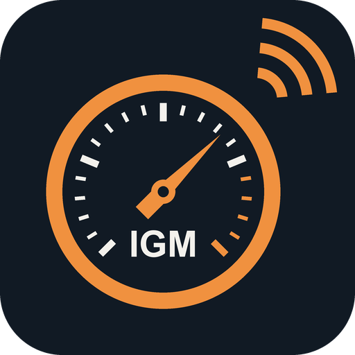
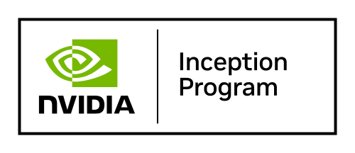
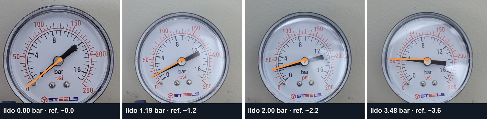
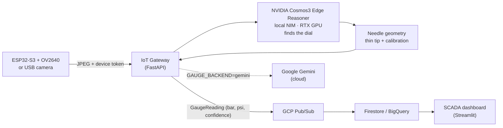

<p align="center">
  
  &nbsp;&nbsp;&nbsp;&nbsp;
  
</p>
<p align="center"><sub>LABRIOT is a member of the NVIDIA Inception program.</sub></p>
<p align="center">
  <a href="https://github.com/ItamarIliuk/industrial-gauge-monitor/actions/workflows/tests.yml"></a>
  <a href="LICENSE"></a>
</p>
<p align="center"><a href="README.md">🇧🇷 Português</a> · 🇺🇸 English · 🌐 <a href="https://itamariliuk.github.io/igm/">Project page</a></p>

# Industrial Gauge Monitor (IGM)

**Turning the analog pressure gauges already installed in factories into connected sensors, with no
instrument replacement and no process downtime.**

A low-cost camera points at an existing gauge. **NVIDIA Cosmos3**, running locally as a NIM on an NVIDIA RTX GPU,
finds the dial, and a deterministic geometric step reads the needle. The pressure in **bar and psi** then goes to
SCADA and to the cloud (Google Cloud Pub/Sub → Firestore/BigQuery → dashboard).
IGM is built by LABRIOT at UTFPR (Brazil) and was a finalist at the ABINC IoT Award 2026 (Academic category).

## 📊 Results



| Test | Mean absolute error | Latency |
|---|---|---|
| 13 bench photos (phone + webcam, 0–3.6 bar) | **0.09 bar** (max 0.27) | 0.45 s median |
| Live USB camera + compressor, check points outside calibration (3, 5, 6 bar) | **~0.09 bar (0.5% of full scale)** | ~0.55 s |

- **No gauge in view, no reading.** Cosmos3 can return `null` for the dial, and the system then raises a
  low-confidence alert instead of making up a value.
- **What we learned:** asked to read the value alone, the Cosmos3 Edge VLM follows the needle's *counterweight*,
  the most salient part of the needle. Using it for **perception** (finding the instrument) and a geometric step for
  **measurement** got 13/13 bench photos right and gives an auditable number.
- **IoT device:** an ESP32-S3 + OV2640 camera (about USD 15–40 per point) posts JPEGs to a FastAPI gateway with
  per-device tokens, remote calibration and a moving median.

Full tables, the architecture and the lessons learned (in Portuguese) are in
[docs/resultados.md](docs/resultados.md).

## 🏗️ Architecture



| Module | Path | What it does |
|---|---|---|
| Edge agent | `edge/` | Camera capture plus the reading backend: `cosmos` (local NIM) or `gemini` (cloud), both producing the same `GaugeReading` schema |
| Gateway | `gateway/` | Receives JPEGs from the devices, authenticates them, keeps the moving median and calibration, and publishes to Pub/Sub |
| Firmware | `firmware/esp32s3-cam/` | ESP32-S3 + OV2640 firmware (PlatformIO): Wi-Fi portal, NVS config, optional deep sleep |
| Cloud | `cloud/` | Cloud Run (Flask) service that consumes Pub/Sub and writes to Firestore and BigQuery |
| UI | `ui/` | Streamlit SCADA dashboard |
| Setup | `setup/cosmos3/` | Docker + NVIDIA Container Toolkit + Cosmos3 NIM on WSL2/Ubuntu |

## ⚡ Quick start

```bash
git clone https://github.com/ItamarIliuk/industrial-gauge-monitor && cd industrial-gauge-monitor
python -m venv .venv && . .venv/bin/activate            # Windows: .venv\Scripts\activate
pip install -r edge/requirements.txt -r cloud/requirements.txt -r gateway/requirements.txt pytest httpx
PYTHONPATH=./edge:./cloud pytest tests -q                 # no GPU and no cloud needed (mocked)
```

- **Local Cosmos3 on an NVIDIA GPU:** start the NIM with [setup/cosmos3](setup/cosmos3/README.md), then run
  `GAUGE_BACKEND=cosmos COSMOS_URL=http://127.0.0.1:8000 python edge/app.py`.
- **Benchmark:** `python bench/compare.py <photo_folder> --backends cosmos,gemini`.
- **Gateway:** `uvicorn gateway.main:app --host 0.0.0.0 --port 8090`. Register a device with `python gateway/new_device.py <device_id> --location "Boiler 1"`.

## 🛣️ Next steps

1. Validation against a calibrated reference gauge.
2. Cosmos3 vs. Gemini on the same images.
3. ESP32 multi-point calibration and dedicated lighting.
4. NVIDIA Jetson as the plant gateway, and synthetic training data with NVIDIA Omniverse and Cosmos.
5. A pilot at an industrial plant.

## License

[Apache-2.0](LICENSE)

---
<sub>© 2026 NVIDIA, the NVIDIA logo, NVIDIA Cosmos, NVIDIA GeForce RTX, NVIDIA Inception, NVIDIA Jetson, NVIDIA NIM and NVIDIA Omniverse are trademarks and/or registered trademarks of NVIDIA Corporation in the U.S. and other countries.</sub>
