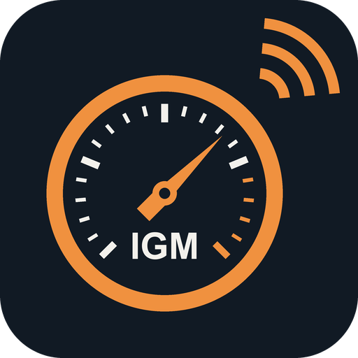
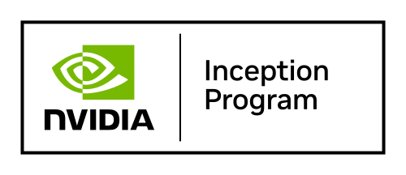
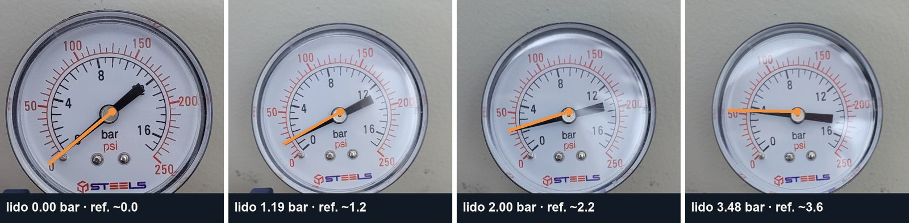

<p align="center">
  
  &nbsp;&nbsp;&nbsp;&nbsp;
  
</p>
<p align="center"><sub>O LABRIOT é membro do NVIDIA Inception program.</sub></p>
<p align="center">
  <a href="https://github.com/ItamarIliuk/industrial-gauge-monitor/actions/workflows/tests.yml"></a>
  <a href="LICENSE"></a>
</p>
<p align="center">🇧🇷 Português · <a href="README.en.md">🇺🇸 English</a> · 🌐 <a href="https://itamariliuk.github.io/igm/">Página do projeto</a></p>

# Industrial Gauge Monitor

Sistema IoT de visão computacional na borda para monitoramento de manômetros industriais.
Integra dispositivos de borda (Edge) com a nuvem GCP usando AI multimodal.
Projeto do LABRIOT · UTFPR, finalista do Prêmio ABINC IoT 2026 (Categoria Acadêmica).

## 📊 Resultados



- **Erro médio de ~0,09 bar (0,5% do fundo de escala)**, tanto em 13 fotos de bancada quanto com a câmera
  ao vivo e o compressor (patamares de 3, 5 e 6 bar fora da calibração).
- **~0,5 s por leitura** com o **NVIDIA Cosmos3** rodando localmente (NIM, RTX 4090), sem enviar imagem para a nuvem.
- **Sem manômetro na cena, sem leitura:** o sistema devolve um alerta, nunca um valor inventado.
- **Dispositivo IoT:** ESP32-S3 com câmera OV2640 (R$ 70 a 200 por ponto) → gateway → Pub/Sub → BigQuery → dashboard SCADA.

Tabelas, arquitetura e lições aprendidas em **[docs/resultados.md](docs/resultados.md)**.

## Módulos
- **Edge**: Captura de imagem e processamento com Vertex AI (Gemma 4 Multimodal) ou, localmente, com NVIDIA Cosmos3 (`GAUGE_BACKEND=cosmos`).
- **Gateway**: API FastAPI que recebe os JPEGs dos dispositivos IoT (`gateway/`).
- **Firmware**: ESP32-S3 + OV2640 em PlatformIO (`firmware/esp32s3-cam/`).
- **Cloud**: Cloud Run (Flask) consumindo mensagens Pub/Sub via push.
- **UI**: Dashboard SCADA construído com Streamlit.
- **Infra**: Scripts Terraform/gcloud para provisionamento de recursos GCP.

## ⚡ Quick start

```bash
git clone https://github.com/ItamarIliuk/industrial-gauge-monitor && cd industrial-gauge-monitor
python -m venv .venv && . .venv/bin/activate            # Windows: .venv\Scripts\activate
pip install -r edge/requirements.txt -r cloud/requirements.txt -r gateway/requirements.txt pytest httpx
PYTHONPATH=./edge:./cloud pytest tests -q                 # testes sem GPU e sem nuvem
```

- **Cosmos3 local (GPU NVIDIA):** subir o NIM com [setup/cosmos3](setup/cosmos3/README.md), depois `GAUGE_BACKEND=cosmos python edge/app.py`.
- **Pipeline GCP + dashboard:** `.\run_project.ps1 setup` (Windows) ou `make setup`. Detalhes em [docs/execucao.md](docs/execucao.md).

## 🟩 Backend local NVIDIA Cosmos3 (sem nuvem)

O Edge Agent aceita dois backends de inferência, escolhidos por `GAUGE_BACKEND`:

| Backend | Onde roda | Imagem sai da planta? | Custo de IA |
| :--- | :--- | :--- | :--- |
| `gemini` (padrão) | Vertex AI (Gemini 3.6 Flash) | Sim | por token |
| `cosmos` | NVIDIA Cosmos3 Edge Reasoner (NIM) na GPU local | **Não** | zero (hardware próprio) |

O backend `cosmos` ([edge/cosmos_backend.py](edge/cosmos_backend.py)) funciona assim: o **Cosmos3 localiza o mostrador**, e uma **medição geométrica da agulha** lê o valor. A ponta fina é o lado mais longo; o contrapeso é ignorado. O ângulo é convertido pelas marcas impressas do mostrador (`GAUGE_CALIB`). A saída usa o **mesmo esquema `GaugeReading`** do Gemini, então Pub/Sub, Firestore, BigQuery e o dashboard não mudam.

```bash
# NIM do Cosmos3 rodando em http://localhost:8000 (como subir: setup/cosmos3/README.md)
GAUGE_BACKEND=cosmos COSMOS_URL=http://localhost:8000 python edge/app.py
```

### Comparação entre backends
```bash
python bench/compare.py <pasta_fotos> --backends cosmos,gemini
```
Usa o mesmo `process_inference` do agente, sem câmera e sem Pub/Sub, e grava `bench/results.csv` com erro, confiança e latência. As referências ficam em `bench/reference_visual.csv`.

Resultado do Cosmos3 em 13 fotos (RTX 4090, referência visual de ±0,2 bar): **MAE de 0,09 bar** no geral, **0,13 bar** com pressão e erro máximo de 0,27 bar, com **cerca de 0,4 s por leitura**.

---

## 📡 Dispositivos IoT de captura (ESP32-S3 + OV2640) e Gateway

Câmeras baratas espalhadas pela fábrica **só capturam e enviam a imagem**. Toda a análise roda no **Gateway**, com Cosmos3 local ou Gemini configurado por dispositivo.

```
[ESP32-S3 + OV2640] ──HTTP POST JPEG──▶ [Gateway :8090] ──▶ Cosmos3 NIM | Gemini ──▶ Pub/Sub → Firestore/BigQuery → SCADA
```

### Gateway (`gateway/`)
```bash
pip install -r gateway/requirements.txt
cp gateway/devices.example.yaml gateway/devices.yaml
python gateway/new_device.py manometro-caldeira-01 --location "Caldeira 1"   # copie o trecho para devices.yaml
GATEWAY_ADMIN_TOKEN=<segredo> PUBLISH_MODE=local uvicorn gateway.main:app --host 0.0.0.0 --port 8090
```
| Endpoint | Função |
| :--- | :--- |
| `POST /v1/ingest/{device_id}` | JPEG cru + `X-Device-Token` → leitura em bar/psi com mediana móvel |
| `POST /v1/calibrate/{device_id}?bar=4` | grava um ponto de calibração a partir das últimas leituras (`X-Admin-Token`) |
| `GET /v1/devices` · `GET /v1/devices/{id}/frame` | estado dos dispositivos e último frame (`X-Admin-Token`) |

Para simular um dispositivo sem hardware: `python gateway/simulate_device.py <device_id> <token> fotos/*.jpg`.

### Firmware (`firmware/esp32s3-cam/`, PlatformIO)
Placa: Freenove ESP32-S3-WROOM CAM (N8R8) + OV2640.
```bash
cd firmware/esp32s3-cam
pio run -t upload && pio device monitor
```
1. Na primeira vez, a placa abre o Wi-Fi **`GaugeCam-XXXX`**. Conecte nele, abra `http://192.168.4.1` e informe: rede Wi-Fi, URL do gateway (`http://IP-da-workstation:8090`), device_id, token, intervalo e resolução.
2. Para reconfigurar depois, com a placa ligada, segure **BOOT** por 3 s (não segure durante o reset: isso entra no modo de gravação).
3. LED: 🟢 leitura ok · 🟠 alerta de visibilidade · 🔴 erro · 🔵 configurando.
4. Com o manômetro em patamares conhecidos, calibre remotamente com `POST /v1/calibrate/{id}?bar=...`.

---
<sub>© 2026 NVIDIA, the NVIDIA logo, NVIDIA Cosmos, NVIDIA GeForce RTX, NVIDIA Inception, NVIDIA Jetson and NVIDIA NIM are trademarks and/or registered trademarks of NVIDIA Corporation in the U.S. and other countries.</sub>
