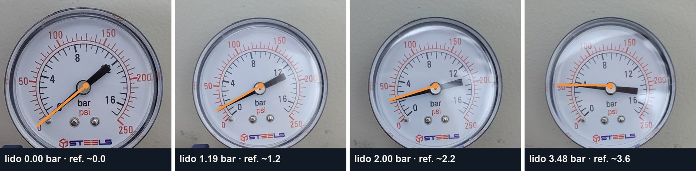
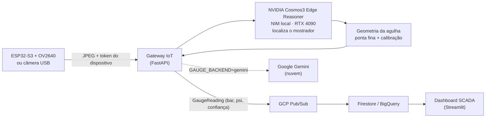
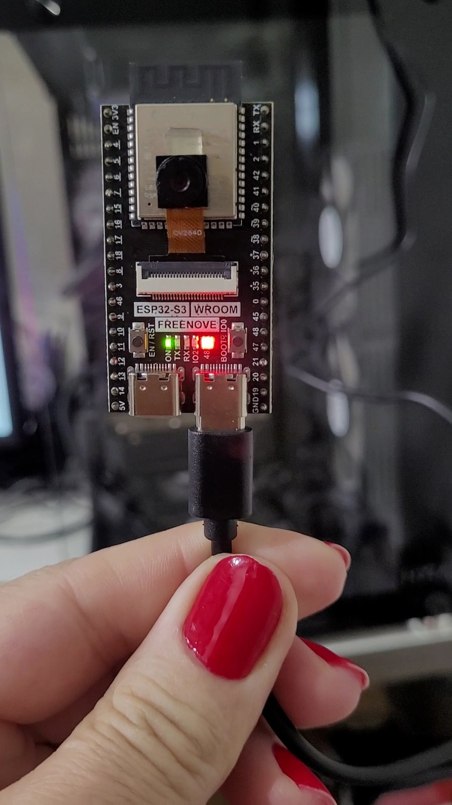
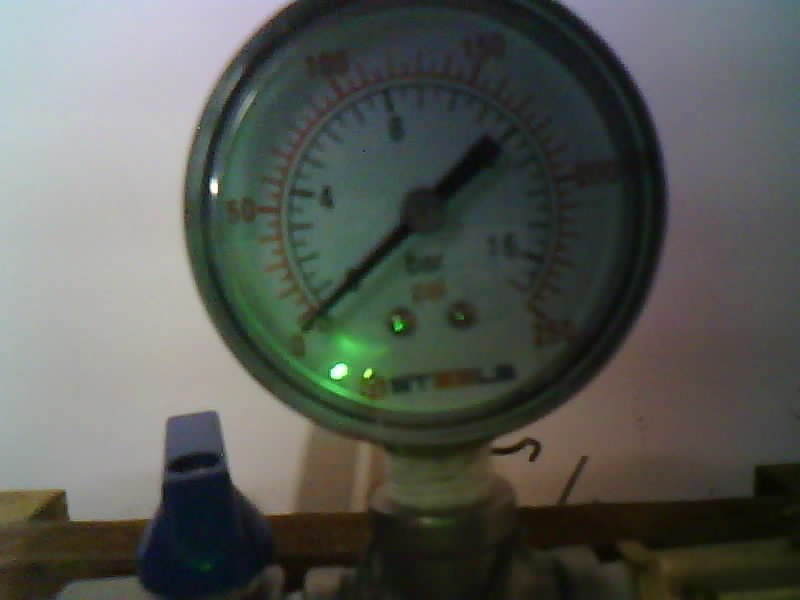
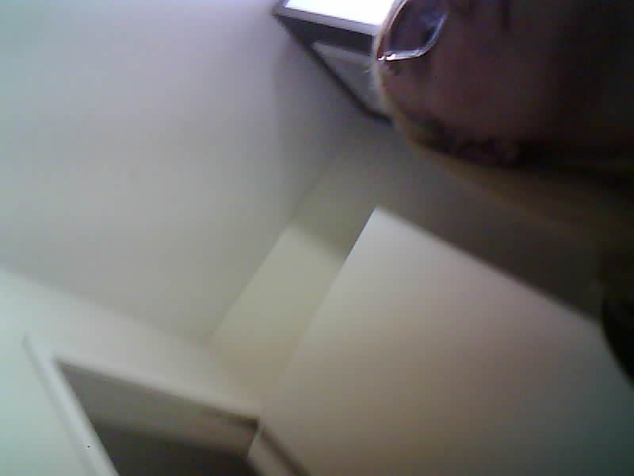
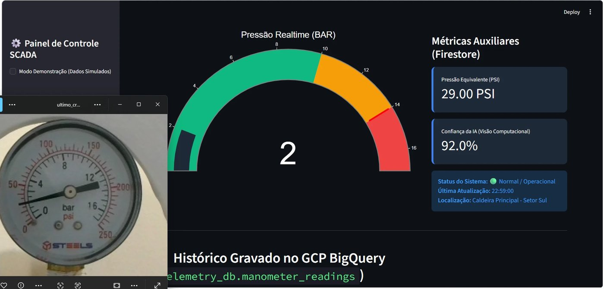
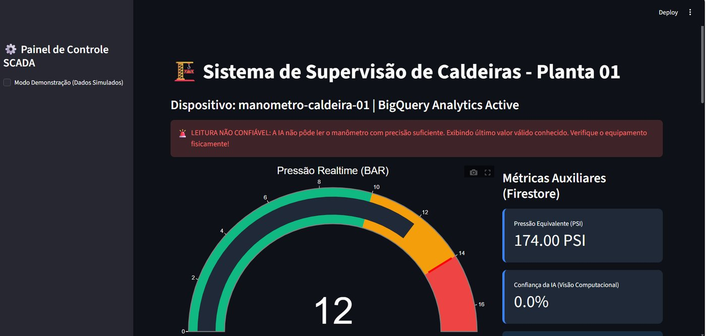

# Resultados: leitura de manômetros analógicos com NVIDIA Cosmos3 na borda

LABRIOT · UTFPR. Projeto finalista do Prêmio ABINC IoT 2026 (Categoria Acadêmica).

**Em resumo:** com uma câmera comum apontada para um manômetro já instalado, o sistema lê a pressão
em **bar e psi** com erro médio de **~0,09 bar (0,5% do fundo de escala)**. Cada leitura leva **~0,5 s** e é
processada inteiramente na borda, numa RTX 4090, com o **NVIDIA Cosmos3** rodando localmente como NIM.
As leituras seguem para o mesmo pipeline de nuvem (Pub/Sub → Firestore/BigQuery → dashboard) que já
usávamos com o Gemini.

## Arquitetura

- **Percepção (Cosmos3):** devolve a caixa do mostrador (`bbox_2d`) ou `null` quando não há manômetro
  na cena. Se não há manômetro, não há leitura: o sistema devolve confiança baixa e um alerta, nunca um
  valor inventado.
- **Medição (geometria):** a partir do pivô, mede o traço escuro mais longo, que é a **ponta fina**.
  O contrapeso, curto e grosso, é ignorado. O ângulo vira pressão por uma calibração por partes,
  feita na posição final da câmera.
- **Dois backends com o mesmo contrato:** `GAUGE_BACKEND=cosmos` (local) ou `gemini` (nuvem). Os dois geram o
  mesmo `GaugeReading`, então o restante do pipeline não muda.

## 1. Bancada com fotos (13 imagens, 0 a 3,6 bar)

Manômetro STEELS de 0–16 bar / 0–250 psi. As imagens vêm de celular e de webcam. A referência é visual,
medida contra as marcas impressas no mostrador (±0,2 bar). Para rodar: `python bench/compare.py <pasta> --backends cosmos`.

| Imagem | Ref. (bar) | Cosmos3 + geometria (bar) | psi | Erro (bar) | Latência (s) |
|---|---|---|---|---|---|
| celular 181830 | 0,0 | 0,00 | 0,0 | 0,00 | 6,23\* |
| celular 181832 | 0,0 | 0,00 | 0,0 | 0,00 | 0,45 |
| celular 190221 | 3,6 | 3,48 | 50,5 | −0,12 | 0,45 |
| celular 190224 | 3,3 | 3,12 | 45,3 | −0,18 | 0,44 |
| celular 190226 | 2,9 | 2,82 | 40,9 | −0,08 | 0,42 |
| celular 190229 | 2,5 | 2,37 | 34,4 | −0,13 | 0,41 |
| celular 190232 | 2,2 | 2,00 | 29,0 | −0,20 | 0,45 |
| celular 190236 | 1,9 | 1,63 | 23,6 | −0,27 | 0,49 |
| celular 190239 | 1,6 | 1,56 | 22,6 | −0,04 | 0,44 |
| celular 190243 | 1,2 | 1,19 | 17,3 | −0,01 | 0,55 |
| celular 190306 | 3,0 | 2,82 | 40,9 | −0,18 | 0,46 |
| webcam (1) | 0,0 | 0,00 | 0,0 | 0,00 | 0,25 |
| webcam | 0,0 | 0,00 | 0,0 | 0,00 | 0,29 |

**Erro médio absoluto: 0,09 bar** (0,13 bar considerando só as 9 imagens com pressão). O erro máximo foi
de 0,27 bar. A latência mediana foi de 0,45 s. \*A primeira requisição inclui o aquecimento do modelo.

## 2. Câmera ao vivo com compressor (patamares de 2 a 8 bar)

Câmera USB de 640×480, calibrada no local em 2, 4 e 8 bar e validada em patamares fora da calibração.
A referência é a leitura do operador. Detalhes em [validacao-cosmos3-camera-ao-vivo.md](validacao-cosmos3-camera-ao-vivo.md).

| Patamar | Leitura (mediana de 5) | Erro |
|---|---|---|
| 6 bar | 5,94 bar · 86,2 psi | −0,06 |
| 5 bar | 4,97 bar · 72,1 psi | −0,03 |
| 3 bar | 3,17 bar · 46,0 psi | +0,17 |

**Erro médio absoluto de ~0,09 bar (0,5% do fundo de escala) e ~0,55 s por leitura.**

## 3. O que aprendemos sobre o Cosmos3

Antes do pipeline híbrido, testamos pedir ao modelo que lesse a pressão sozinho:

| Estratégia | Acertos (4 fotos em 0 bar) |
|---|---|
| Cosmos3 Edge lendo o valor direto | 0 a 1 de 4: segue o **contrapeso**, que é a parte mais saliente da agulha |
| Cosmos3 com recorte + votação (7 amostras) | 0 de 4: a votação não corrige um viés sistemático |
| **Cosmos3 localiza + geometria mede a ponta fina** | **4 de 4** e depois 13 de 13 na bancada |

O papel que funcionou para o Cosmos3 Edge é a **percepção**: achar o instrumento na cena e dizer quando
ele não está lá. A medição fina fica com um algoritmo determinístico e auditável. A divisão também ajuda
na certificação, porque a parte que gera o número é simples de validar.

## 4. Dispositivo IoT: ESP32-S3 + câmera OV2640

| A placa | O que ela envia ao gateway | Sem manômetro na cena |
|---|---|---|
|  |  |  |
| Custo de R$ 70 a 200 por ponto | Frame real lido como 0 bar | Frame rejeitado: confiança 0,2 + alerta |

- **Firmware** em [`firmware/esp32s3-cam`](../firmware/esp32s3-cam):
  - Portal Wi-Fi para configuração (segurar BOOT por 3 s para abrir).
  - Token individual por dispositivo, guardado na NVS.
  - Comandos pela serial e opção de deep sleep.
- **Gateway** em [`gateway/`](../gateway):
  - Autenticação por dispositivo (só o hash SHA-256 do token fica no servidor).
  - Mediana móvel das leituras.
  - Calibração remota (`POST /v1/calibrate/{id}?bar=`), que recusa amostras instáveis.
  - Publicação no Pub/Sub no mesmo formato do Edge Agent.
- **Estado atual:**
  - Calibrado no ponto de 0 bar.
  - Pendente: calibração em 2, 4 e 8 bar e iluminação dedicada. O reflexo do LED da placa no vidro do mostrador aparece no frame acima.

## 5. Do manômetro ao SCADA

| Leitura válida | Leitura rejeitada |
|---|---|
|  |  |
| 2 bar · 29 psi · 92% de confiança, gravada no Firestore e no BigQuery | Leitura não confiável (0% de confiança): o dashboard mostra um alerta para verificar o equipamento e mantém o último valor válido |

## Infraestrutura usada

- **Modelo:** NVIDIA Cosmos3 Edge Reasoner, precisão FP8, NIM `nvcr.io/nim/nvidia/cosmos3:2.1.0`, API compatível com OpenAI.
- **Máquina:** workstation com RTX 4090 (24 GB), Windows 11 + WSL2 Ubuntu 24.04 + Docker. O modelo usa ~19 GB de VRAM.
- **Observação:** a RTX 4090 não está entre as GPUs suportadas por esse perfil do NIM. Para os experimentos, ajustamos
  localmente a checagem de hardware do container. Em produção, o alvo é uma plataforma suportada
  oficialmente, como Jetson ou GPU de data center.

## Limitações e próximos passos

1. **Referência metrológica:** comparar com um **manômetro padrão calibrado**, e não só com a leitura visual ou do operador.
2. **Comparar com o Gemini:** rodar Cosmos3 e Gemini nas mesmas imagens com `bench/compare.py --backends cosmos,gemini`.
3. **ESP32:** calibrar em vários pontos, adicionar iluminação dedicada e validar em patamares.
4. **Mais manômetros:** testar outros modelos e escalas, e várias câmeras por gateway.
5. **Piloto em planta** com parceiro industrial.

---
O LABRIOT é membro do NVIDIA Inception program. © 2026 NVIDIA, the NVIDIA logo, NVIDIA Cosmos, NVIDIA GeForce RTX, NVIDIA Inception, NVIDIA Jetson and NVIDIA NIM are trademarks and/or registered trademarks of NVIDIA Corporation in the U.S. and other countries.
